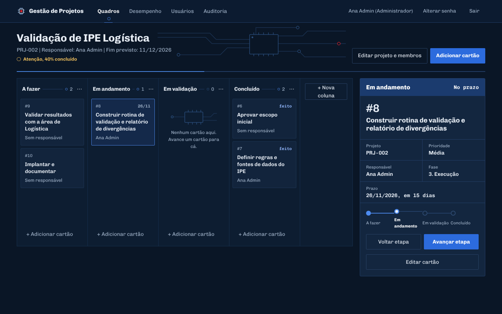
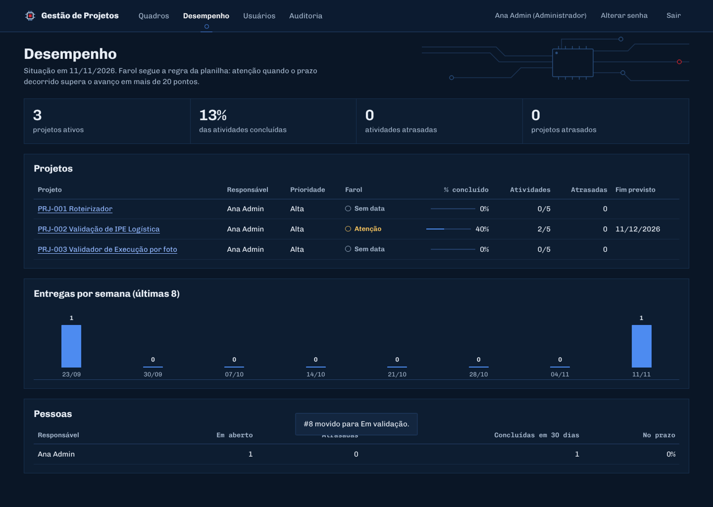
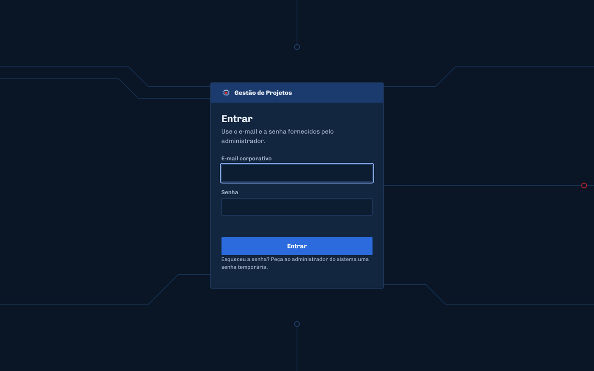

# Gestão de Projetos

Quadros no estilo kanban para acompanhar projetos, com painel de desempenho, controle de acesso por login e senha e trilha de auditoria. Pensado para rodar na rede interna da empresa.

Os três projetos iniciais (Roteirizador, Validação de IPE Logística e Validador de Execução por foto) são carregados com as mesmas atividades e fases da planilha de acompanhamento e do modelo de escopo.



| Desempenho | Entrada |
|---|---|
|  |  |

## Demonstração sem instalar

| Endereço | O que é |
|---|---|
| https://lubritecbi.github.io/Gestao-de-Projetos/ | **Plataforma em uso**: telas no GitHub Pages, login, banco e permissões no Supabase (plano gratuito) |
| https://lubritecbi.github.io/Gestao-de-Projetos/demo/ | Demonstração: dados só no navegador, sem segurança real (senha de exemplo `Demo#2026-Teste`) |

A demonstração também pode ser aberta com dois cliques em `docs/demo/index.html`.

## Versão GitHub Pages + Supabase

O GitHub Pages só hospeda arquivos estáticos. Por isso, nessa versão:

| Parte | Onde fica | Arquivos |
|---|---|---|
| Telas | GitHub Pages | `web/` (mesmas telas de `public/`, com caminhos relativos) |
| Ponte telas → Supabase | GitHub Pages | `web/api-supabase.js` responde às chamadas `/api/...` das telas usando o Supabase |
| Login e senhas | Supabase Auth | cadastro público desligado; só o admin cria acessos |
| Banco e permissões | Supabase (PostgreSQL + RLS) | `supabase/01_banco.sql`, `supabase/03_ajustes_telas.sql`, `supabase/05_checklists.sql` (checklists nos cartões), `supabase/06_anexos.sql` (anexos nos cartões) |
| Anexos dos cartões (imagens e PDF) | Supabase Storage (depósito privado `anexos`) | `supabase/06_anexos.sql`; até 5 MB por arquivo; só membros do projeto abrem ou baixam |
| Primeiro administrador | Supabase | `supabase/02_primeiro_admin.sql` |
| Backup e manter ativo | GitHub Actions | `.github/workflows/backup-supabase.yml`, `supabase/04_restaurar_gatilho.sql` |
| Gestão de usuários (admin) | Supabase Edge Function | `supabase/functions/admin-usuarios/index.ts` (no Supabase: nome `admin-usuarios`, endereço `/functions/v1/hyper-endpoint`, **Verify JWT desligado**) |

**Quem decide as permissões é o banco**, não a página: as regras RLS conferem perfil, participação no quadro, usuário ativo e troca da senha temporária em cada consulta. A chave em `web/config.js` é a pública (anon/publishable) e pode ficar no GitHub; a chave secreta (service_role) existe só dentro da Edge Function. O fluxo de publicação bloqueia o envio se encontrar uma chave secreta.

A publicação é automática pelo fluxo `.github/workflows/Pages.yml` a cada envio na `main` que altere `web/` ou `docs/demo/` (também pode ser rodado em **Actions > Publicar no GitHub Pages > Run workflow**). Em **Settings > Pages > Build and deployment > Source** deve estar selecionado **GitHub Actions**, e o campo **Custom domain** deve ficar vazio.

Diferenças em relação à versão com servidor próprio: o bloqueio por tentativas erradas e os limites de acesso são os do Supabase (não os 5 erros / 15 minutos); a saída por 30 minutos de inatividade é feita pela página; o projeto gratuito do Supabase pausa após cerca de 7 dias sem acesso (os dados são mantidos), o que a tarefa de backup abaixo evita.

A senha de um usuário não pode ser lida, só substituída: pelo botão **Redefinir senha** na tela Usuários ou, para o administrador, no SQL Editor do Supabase com `update auth.users set encrypted_password = extensions.crypt('NovaSenha', extensions.gen_salt('bf')) where email = '...'`.

### Backup e restauração (Supabase)

O fluxo `.github/workflows/backup-supabase.yml` roda segunda, quarta e sexta de madrugada. Ele conecta no banco (o que mantém o projeto gratuito ativo) e gera um backup **criptografado com AES-256**, guardado por 30 dias na aba **Actions** (execução > **Artifacts**). Como o repositório é público, sem a senha o arquivo é inútil.

**Atenção:** esse backup copia o banco (inclusive a lista de anexos), mas **não** os arquivos anexados, que ficam no Storage do Supabase. Para guardar uma cópia dos arquivos, baixe-os em Supabase > Storage > `anexos`.

Configuração única, em **Settings > Secrets and variables > Actions > New repository secret**:

| Segredo | Valor |
|---|---|
| `SUPABASE_DB_URL` | Supabase > **Connect** > **Session pooler** > URI, trocando `[YOUR-PASSWORD]` pela senha do banco |
| `BACKUP_PASSPHRASE` | Uma frase longa (20+ caracteres). **Guarde fora do GitHub**: sem ela não há como abrir os backups |

Restaurar (num projeto novo ou após um problema):

1. Baixe o artifact e descriptografe: `gpg -d gestao-supabase-AAAA-MM-DD_HHMM.tar.gz.gpg | tar -xz` (no Windows, use o Gpg4win e o 7-Zip). Saem `02_logins.sql`, `01_sistema.sql` e `resumo.txt`.
2. Rode, nesta ordem, no SQL Editor (ou com `psql`): `02_logins.sql`, `01_sistema.sql` e `supabase/04_restaurar_gatilho.sql`. Se algum passo der erro, pare: as regras de permissão são aplicadas no fim do `01_sistema.sql`.
3. Confira os totais mostrados pelo `04_restaurar_gatilho.sql` com o `resumo.txt`.
4. Se for um projeto novo: republique a Edge Function, refaça as configurações de Authentication (cadastro público desligado, política de senha, Site URL) e atualize `web/config.js` com a nova Project URL e chave pública.

Atenção: o GitHub desliga tarefas agendadas de repositórios públicos após 60 dias sem nenhum commit e avisa por e-mail. Se isso acontecer, reative em **Actions > Backup do Supabase > Enable workflow**.

Para rodar com servidor próprio (Node.js + SQLite), siga as seções de instalação abaixo.

## O que o sistema faz

| Área | Recursos |
|---|---|
| Quadros | Um quadro por projeto, colunas editáveis (A fazer, Em andamento, Em validação, Concluído), cartões com responsável, prazo, prioridade, fase, checklists (várias por cartão, com contador de itens marcados no quadro) e anexos (imagens e PDF até 5 MB: botão, Ctrl+V para colar print ou arrastar o arquivo); etiqueta do cartão ao lado com botões para avançar ou voltar etapa; arrastar e soltar |
| Desempenho | % concluído e farol por projeto (mesma regra da planilha), atividades atrasadas, entregas por semana, carga e pontualidade por pessoa |
| Usuários | Somente o administrador cria acessos; senha temporária com troca obrigatória; redefinir senha, desbloquear, desativar, mudar perfil |
| Auditoria | Registro de logins, falhas, bloqueios, alterações de usuários, projetos e cartões, com IP e horário |

Perfis: **Administrador** (tudo), **Gestor** (cria projetos e gerencia os quadros de que participa), **Membro** (cria e move cartões nos quadros de que participa) e **Leitor** (apenas visualiza). Cada pessoa só enxerga os quadros dos quais é membro.

## Instalação rápida (servidor Linux com Docker)

```bash
cp .env.example .env            # ajuste as variáveis
docker compose up -d --build
docker compose exec gestao node scripts/create-admin.js ti@empresa.com.br "Nome do Administrador"
docker compose exec gestao node scripts/seed.js     # opcional: carrega os 3 projetos
```

Depois configure o proxy reverso com HTTPS usando `deploy/nginx.conf.example`. O contêiner só aceita conexões vindas do próprio servidor (127.0.0.1).

## Instalação sem Docker (Linux ou Windows Server)

Requer Node.js 22.9 ou superior.

```bash
npm ci --omit=dev
cp .env.example .env
npm run create-admin -- ti@empresa.com.br "Nome do Administrador"
npm run seed          # opcional
npm start
```

Para manter o serviço no ar use systemd (Linux) ou NSSM / Agendador de Tarefas (Windows). Publique sempre atrás de Nginx ou IIS com HTTPS.

Para testar no próprio computador sem HTTPS, use `NODE_ENV=development` e `COOKIE_SECURE=false` no `.env` e acesse `http://localhost:3000`.

## Controles de segurança implementados

| Risco | Controle |
|---|---|
| Vazamento de senhas | Hash scrypt (N=2^15, r=8) com sal único; senhas nunca ficam em texto nem nos logs |
| Senhas fracas | Mínimo de 12 caracteres, 3 tipos de caractere, bloqueio de senhas comuns e de senhas com nome ou e-mail |
| Força bruta | Bloqueio da conta após 5 erros por 15 min, limite de 10 tentativas por IP e 20 por e-mail; limite extra no Nginx |
| Descoberta de usuários | Mesma mensagem e mesmo tempo de resposta para e-mail inexistente e senha errada |
| Roubo de sessão | Token aleatório de 256 bits em cookie HttpOnly, Secure, SameSite=Strict e prefixo `__Host-`; no banco fica só o hash do token |
| Sessão esquecida aberta | Expira após 30 min sem uso e 10 h no máximo; troca de senha e desativação encerram as sessões |
| Fixação de sessão | Nova sessão a cada login, descartando a anterior |
| CSRF | SameSite=Strict, verificação de Origin, exigência de JSON e token por sessão no cabeçalho `X-CSRF-Token` |
| XSS | CSP sem scripts inline nem externos; a interface insere texto só via `textContent` |
| SQL injection | Somente consultas parametrizadas (better-sqlite3) |
| Dados malformados | Validação com Zod: tipos, tamanhos, datas, campos desconhecidos recusados |
| Acesso indevido | Autorização no servidor em toda rota, por perfil e por participação no quadro; quadros alheios respondem 404 |
| Clickjacking e afins | Helmet: frame-ancestors none, nosniff, HSTS, Referrer-Policy, Permissions-Policy |
| Exposição de erros | Mensagens genéricas com código de rastreio; detalhes só no log do servidor |
| Rastreabilidade | Trilha de auditoria com retenção configurável (padrão 365 dias) |
| Dependências | Versões fixadas e sem vulnerabilidades conhecidas no `npm audit` da entrega |
| Contêiner | Usuário sem privilégios, sistema de arquivos somente leitura, sem capabilities |

Os testes automatizados (`npm test`) verificam esses controles: cabeçalhos, CSRF, bloqueio de conta, isolamento entre usuários, permissões por perfil, troca obrigatória de senha e encerramento de sessões.

## Rotina de operação

1. **Backup diário**: `npm run backup` (ou `docker compose exec gestao node scripts/backup.js`). Guarde as cópias fora do servidor. Mantém as 30 mais recentes.
2. **Desligamentos**: desative o usuário no mesmo dia da saída da pessoa. As sessões dele são encerradas na hora.
3. **Atualizações**: rode `npm audit` todo mês e atualize as dependências quando houver correções.
4. **Revisão de acessos**: a cada trimestre, confira na tela Usuários quem tem perfil Administrador e Gestor.
5. **Auditoria**: acompanhe eventos `conta.bloqueada` e `login.falha` em sequência, que indicam tentativa de invasão.

## Próximos passos recomendados

Integrar o login ao Active Directory / Microsoft Entra ID (SSO) e ativar autenticação em dois fatores, para não depender de senhas locais. Para mais de cerca de 200 usuários simultâneos ou várias instâncias, migrar o banco para PostgreSQL e o limitador de tentativas para Redis.

## Estrutura

```
.github/
  workflows/ci.yml     testes e auditoria de dependências a cada envio
  dependabot.yml       atualizações automáticas de segurança
deploy/                exemplo de Nginx com HTTPS
docs/
  demo/index.html      demonstração que roda só no navegador
  img/                 imagens usadas neste README
public/                interface (HTML, CSS, JS, fontes e desenhos, sem dependências externas)
scripts/               criar administrador, carga inicial, backup
src/
  server.js            servidor, cabeçalhos de segurança, rotas
  security/            senhas, sessões, CSRF, limite de tentativas
  access.js            perfis e permissões por quadro
  routes/              autenticação, usuários, quadros, cartões, painel
  db.js                banco SQLite e migrações
test/                  testes de segurança
.env.example           modelo de configuração (copie para .env)
Dockerfile, docker-compose.yml
SECURITY.md            cuidados com o repositório e como relatar falhas
```

## Publicar no GitHub

1. Crie um repositório **privado** no GitHub, sem README, `.gitignore` ou licença (eles já vêm aqui).
2. Envie os arquivos. Pelo terminal:
   ```bash
   git init
   git add .
   git commit -m "Primeira versão da Gestão de Projetos"
   git branch -M main
   git remote add origin https://github.com/<usuario>/<repositorio>.git
   git push -u origin main
   ```
   Sem terminal, use **Add file > Upload files** no GitHub e arraste o conteúdo da pasta. As pastas que começam com ponto (como `.github`) podem não ir pelo navegador; nesse caso crie `.github/workflows/ci.yml` pelo botão **Add file > Create new file** e cole o conteúdo.
3. Antes do primeiro envio, confira que não há `.env`, pasta `data/` nem arquivos `.db` na lista.
4. Siga as recomendações do `SECURITY.md` (Dependabot, verificação de segredos e proteção da branch `main`).
